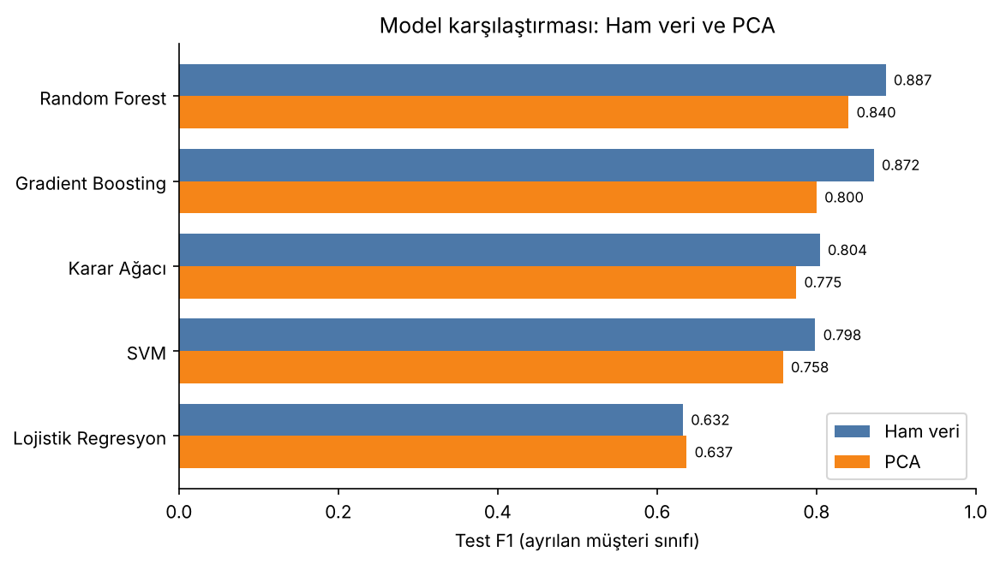
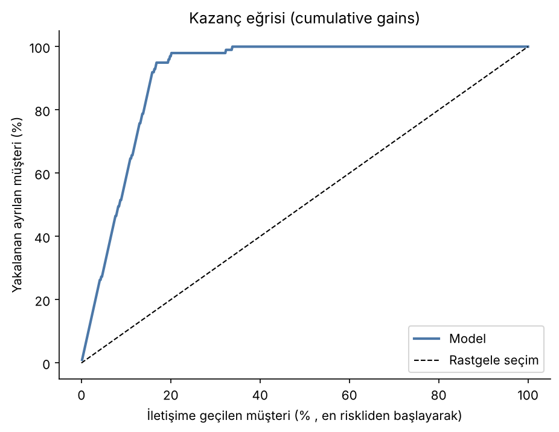
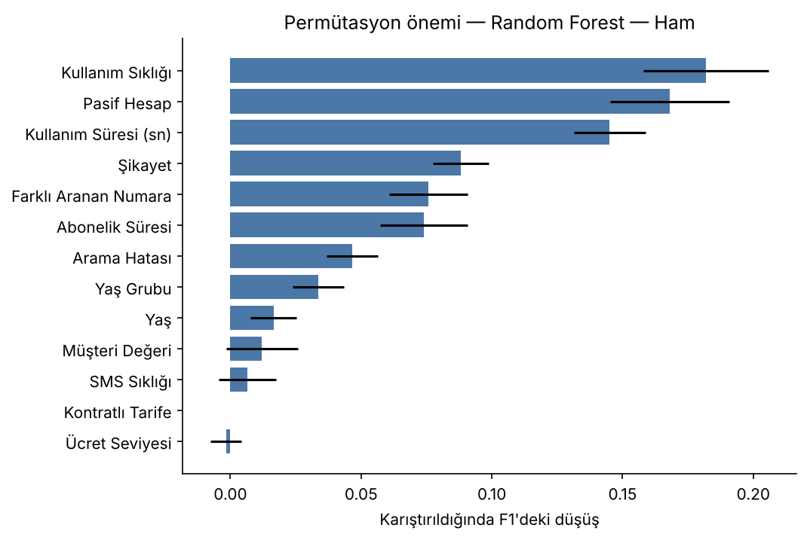

# Müşteri Kaybı (Churn) Tahmini

Bir telekom şirketinin 3.150 müşterisine ait 9 aylık kullanım verisiyle, sonraki 3 ay içinde hangi müşterilerin şirketten ayrılacağını tahmin eden makine öğrenmesi projesi.

> *English summary: Customer churn prediction on the UCI Iranian Churn dataset. Five classifiers were compared on raw and PCA-reduced features inside leak-free scikit-learn pipelines. The best model (Random Forest) reaches 0.96 accuracy, 0.89 F1 and 0.99 ROC-AUC on the held-out test set, and contacting the riskiest 20% of customers would reach 97% of actual churners.*

## İş problemi

Yeni müşteri kazanmak, mevcut müşteriyi elde tutmaktan genellikle çok daha maliyetlidir. Ayrılma riski yüksek müşterileri önceden belirlemek, elde tutma kampanyalarını doğru kişilere yönlendirmeyi sağlar. Aynı yaklaşım sigortacılıkta poliçe yenilememe, bankacılıkta hesap kapatma ve abonelik işlerinde iptal tahmini gibi problemlere doğrudan uygulanabilir.

## Öne çıkan sonuçlar

| | |
|---|---|
| **En iyi model** | Random Forest (ham veri) |
| **Test doğruluğu** | %96,2 |
| **F1 (ayrılan müşteri)** | 0,887 |
| **Recall** | %95: ayrılan 99 müşteriden 94'ü yakalandı |
| **ROC-AUC** | 0,987 |
| **Kampanya etkisi** | En riskli %20 müşteriye ulaşıldığında gerçekte ayrılanların **%97'si** yakalanıyor |





**Ayrılmayı en çok belirleyen değişkenler:** kullanım sıklığı ve süresi, hesabın pasif olması, şikayet durumu ve abonelik süresi.



## Yöntem

1. **Keşifsel analiz:** Korelasyon matrisi ve VIF ile çoklu bağlantı incelendi (Yaş/Yaş Grubu, Kullanım Süresi/Sıklığı, SMS/Müşteri Değeri arasında yüksek ilişki).
2. **Sızıntısız ön işleme:** Veri önce eğitim (%80) ve test (%20) olarak ayrıldı. Ölçekleme ve PCA, `Pipeline` içinde yalnızca eğitim verisiyle öğrenildi. Böylece çapraz doğrulamanın her katında da test verisi ön işlemeye sızmadı.
3. **PCA:** %95 varyansı açıklamak için 9 bileşen gerekti (%97,4).
4. **Modeller:** Lojistik Regresyon, Karar Ağacı, Random Forest, SVM ve Gradient Boosting; her biri ham veri ve PCA verisiyle. Hiperparametreler 5 katlı tabakalı çapraz doğrulama ve F1 ölçütüyle `RandomizedSearchCV` ile arandı.
5. **Değerlendirme:** Hedef değişken dengesiz (%16 ayrılma), bu yüzden doğruluğun yanında F1, precision, recall, specificity, ROC-AUC ve PR-AUC raporlandı. Aşırı öğrenme eğitim/test farkı ve öğrenme eğrisiyle kontrol edildi.
6. **Yorumlama:** Permütasyon önemi, budanmış karar ağacı görselleştirmesi ve kazanç eğrisi.
7. **Ek karşılaştırma:** Random Forest için Grid Search ile Randomized Search, aynı test performansına ulaştı (F1 0,904). Randomized Search daha kısa sürdü.

## Tüm sonuçlar (test seti)

| Model | Doğruluk | F1 | Recall | Precision | ROC-AUC |
|---|---|---|---|---|---|
| Random Forest — Ham | 0,962 | 0,887 | 0,949 | 0,832 | 0,987 |
| Gradient Boosting — Ham | 0,960 | 0,872 | 0,859 | 0,885 | 0,981 |
| Random Forest — PCA | 0,944 | 0,840 | 0,929 | 0,767 | 0,976 |
| Karar Ağacı — Ham | 0,938 | 0,804 | 0,808 | 0,800 | 0,888 |
| Gradient Boosting — PCA | 0,941 | 0,800 | 0,747 | 0,860 | 0,972 |
| SVM — Ham | 0,922 | 0,798 | 0,980 | 0,674 | 0,981 |
| Karar Ağacı — PCA | 0,927 | 0,775 | 0,798 | 0,752 | 0,877 |
| SVM — PCA | 0,902 | 0,758 | 0,980 | 0,618 | 0,972 |
| Lojistik Regresyon — PCA | 0,844 | 0,637 | 0,869 | 0,503 | 0,914 |
| Lojistik Regresyon — Ham | 0,841 | 0,632 | 0,869 | 0,497 | 0,915 |

Ayrıntılı tablo: [`results/model_karsilastirma.csv`](results/model_karsilastirma.csv)

**Çıkarımlar**
- PCA çoklu bağlantıyı gideriyor ancak bu veri setinde tahmin başarısını artırmadı. Ağaç tabanlı modeller çoklu bağlantıdan zaten etkilenmez ve PCA bilgiyi yorumlanması zor bileşenlere dağıtır.
- SVM en yüksek recall'a ulaştı (%98) ama daha çok yanlış alarm üretti. Kampanya maliyeti düşükse ve hiçbir ayrılan müşteri kaçırılmamak isteniyorsa tercih edilebilir.
- Tek karar ağacı ve Gradient Boosting, eğitim verisinde topluluk modellerine göre daha belirgin aşırı öğrenme gösterdi.

## Sınırlılıklar

Veri tek bir şirketten ve 3.150 müşteriden oluşuyor. Sonuçlar tek bir eğitim/test ayrımına dayanıyor. Gerçek bir uygulamada karar eşiği, kampanya maliyeti ile kaybedilen müşterinin değeri karşılaştırılarak seçilmelidir.

## Çalıştırma

```bash
pip install -r requirements.txt
jupyter notebook churn_analizi.ipynb
```

Veri `data/Customer Churn.csv` konumunda olmalıdır. Grafikler `figures/`, tablolar `results/` klasörüne kaydedilir.

## Veri

[UCI Iranian Churn Dataset](https://archive.ics.uci.edu/dataset/563/iranian+churn+dataset), CC BY 4.0 lisansıyla.

## Proje hakkında

Bu çalışma, Hacettepe Üniversitesi İstatistik Bölümü **İST 439 Makine Öğrenmesi** dersinin dönem projesi olarak **İrem Esma Üner** ve **Selin Nur Dölek** tarafından hazırlanmıştır. Bu depodaki sürüm, ders sonrasında İrem Esma Üner tarafından yeniden düzenlenmiştir: ön işleme pipeline'a taşındı, metrik hesaplamaları düzeltildi ve iş odaklı analiz eklendi. Bu nedenle sayılar ders raporundaki değerlerden biraz farklıdır.

**Katkılar**
- İrem Esma Üner: _[PCA, Random Forest, SVM, sonuç]_
- Selin Nur Dölek: _[karar ağacı, gradient boosting, sonuç]_
